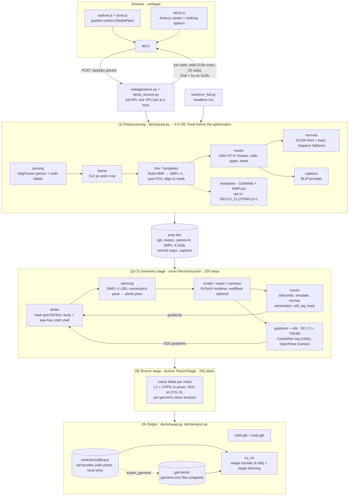

# ClothSense: separate 3D cloth and body from one photo

ClothSense rebuilds **DeClotH** (Nam et al., CVPR 2025) from released parts. You take a full-body photo, and about
15 minutes later on a laptop GPU you get two meshes: a 3D **body** and a separate 3D **garment**. Both are refined
with diffusion guidance and textured from the photo. Because cloth and body are separate, garments reconstructed
from one person can be tried on another.

Course project for **CS4661 - Modern 3D Vision Techniques**, by
[Prajesh Raam](https://github.com/hotaru-py), [Pranav B](https://github.com/Pranav-B-0071) and
[Sachin S R](https://github.com/sachinsr11).

DeClotH did not release code or its trained diffusion models, so each step of the paper is rebuilt here from public components. Where a component is missing, we use a stand-in; each one is listed below.

## What the demo does

1. **Take or upload a photo.** The web page has a guided camera mode: it checks the pose live and takes the
   shot automatically.
2. **Watch the reconstruction.** Draft meshes stream into a 3D viewer every 25 optimisation steps, then the
   textured result appears.
3. **Swap garments.** Clothing options show a thumbnail of each garment: the two example garments shipped in
   `garments/`, plus every reconstruction finished on your machine. Picking one fits it onto your body.

## Architecture



The two GPU-heavy halves never share the 8 GB card: the preprocessing models run first and are freed, then the
diffusion stack (SD 1.5 + two ControlNets, ~3.8 GB) is loaded for the geometry and texture stages. Inside
preprocessing, ECON is parked in system RAM until SAM is done. Each box in the diagram is one module in `declo/`.

## How it works

| DeClotH step (paper)                         | This implementation                                                                                                                                                                                                       |
| -------------------------------------------- | ------------------------------------------------------------------------------------------------------------------------------------------------------------------------------------------------------------------------- |
| Silhouettes                                  | SegFormer human parsing ([mattmdjaga/segformer_b2_clothes](https://huggingface.co/mattmdjaga/segformer_b2_clothes)), refined with SAM ViT-H                                                                               |
| Body template (SMPL-X)                       | Multi-HMR, plus a field-of-view search when the photo has no EXIF focal length, plus a translation fit to the person mask                                                                                                 |
| Cloth template (ClothWild)                   | Default: a garment region on the SMPL-X body taken from the cloth mask. ClothWild + SMPLicit are wired in but **off by default**: their garments were looser and longer than the real clothes (sleeves over the forearms) |
| Front / back normal maps (ECON)              | ECON's normal estimator, front and back. Sapiens-normal 0.3B gives the front map if ECON is missing                                                                                                                       |
| Two DMTets (cloth, body), SMPL-X skinning    | Hash-grid DMTets as in supp. S4. The cloth is a tear-free shell, `sdf = max(abs(f) - tau, g)`                                                                                                                             |
| Cloth SDS with ClothDiffusion (not released) | Stand-in: Stable Diffusion 1.5 + ControlNet **seg**, with the cloth silhouette painted as the ADE20K "apparel" class                                                                                                      |
| Human SDS with HumanDiffusion                | Stable Diffusion 1.5 + ControlNet OpenPose                                                                                                                                                                                |
| Prompts from BLIP                            | BLIP-large: "a photo of a person wearing ..."                                                                                                                                                                             |
| Texture stage (L2 + LPIPS + SDS)             | Same, with per-garment colour anchors                                                                                                                                                                                     |
| Garment swap                                 | Garment moved with the body-shape difference (k-NN over SMPL-X vertices), then posed with the target's skinning                                                                                                           |

**Additions that are not in the paper**, each measured in `PLAN_DECLOTH.md`:

- A penetration loss: body inside the cloth's inner surface. The paper lists inter-penetration as a limitation.
- An arm-aware cloth silhouette.
- A one-sided body template.
- A weak 3D anchor on both SDFs (`w_keep`). Without it, long runs drift and the cloth can vanish.
- A pure-PyTorch differentiable renderer with analytic edge antialiasing. nvdiffrast is optional, and its own
  antialiasing gives no silhouette gradient on meshes this fine.

**Measured results** on the test photo with the default settings (150 geometry + 200 texture steps, RTX 3070 Ti
Laptop 8 GB, about 14 min):

- silhouette IoU against the photo: person 0.96, cloth 0.95;
- body poking through the cloth: about 1.3 % of the cloth pixels over 8 views.

A 4000-step run (the paper's schedule, about 2.7 h) reaches person 0.985 and cloth 0.97 on a second photo.

**Known limitations:**

- Surfaces are bumpier than in the paper.
- Unseen sides get their texture from diffusion only.
- Long runs grow a cap-like shape on the head.
- A swap shows body regions that were hidden under the person's own clothes, and their texture is not real skin.

## Requirements

- An NVIDIA GPU with **8 GB** of VRAM or more, and CUDA. Everything was developed on Windows 11 with an RTX 3070 Ti Laptop.
- Python 3.10.
- About 15 GB of disk for the models.
- A free account at [smpl-x.is.tue.mpg.de](https://smpl-x.is.tue.mpg.de) for the SMPL-X body model.

## Setup

```
python -m venv .venv
.venv\Scripts\pip install torch torchvision --index-url https://download.pytorch.org/whl/cu126
.venv\Scripts\pip install -r requirements.txt
.venv\Scripts\python tools\setup_models.py
```

`setup_models.py` downloads everything that needs no registration (about 12 GB; re-running skips what is already
there):

- Stable Diffusion 1.5, ControlNet openpose and seg, TAESD, BLIP, SegFormer and Sapiens, into the Hugging Face
  cache;
- SAM ViT-H, into `models/sam/`;
- the Multi-HMR and ECON repositories, into `work/`;
- ECON's normal estimator.

Then add SMPL-X by hand: log in at smpl-x.is.tue.mpg.de, download the SMPL-X model, and put
`SMPLX_NEUTRAL.npz` in `models/smplx/`.

On Linux and macOS, use `.venv/bin/python` instead of `.venv\Scripts\python`.

<details><summary>Optional: the ClothWild cloth template (off by default)</summary>

1. Clone [ClothWild](https://github.com/hygenie1228/ClothWild_RELEASE) into `work/ClothWild` and
   [SMPLicit](https://github.com/enriccorona/SMPLicit) into `work/SMPLicit`.
2. Put ClothWild's released weights in `work/ClothWild/demo/snapshot_7.pth.tar`.
3. Download SMPL (python, v1.1.0) from [smpl.is.tue.mpg.de](https://smpl.is.tue.mpg.de) into `work/downloads/`, then unpack it:
   `.venv\Scripts\python -c "import sys; sys.path.insert(0,'tools'); import fetch_mpi; fetch_mpi.unpack_smpl(['work/downloads/SMPL_python_v.1.1.0.zip'])"`
4. Run with the environment variable `DECLO_CLOTHWILD=1`.
</details>

<details><summary>Optional: nvdiffrast</summary>

Build nvdiffrast against CUDA Toolkit 12.6 with MSVC v143 (the VS 2022 toolset; nvcc 12.6 rejects newer MSVC),
then set `DECLO_RENDER=nvdiffrast`. It speeds up rasterisation; the default PyTorch renderer converged better in
our tests.

</details>

## Run

```
.venv\Scripts\python webapp\serve.py              # http://localhost:8000
.venv\Scripts\python webapp\serve.py --https      # https://<LAN IP>:8443, so a phone on the same Wi-Fi can use its camera
.venv\Scripts\python tools\run_full.py photo.jpg [geometry_steps=150] [texture_steps=200]   # headless
```

For a phone, `--https` creates a self-signed certificate the first time it runs; accept the browser warning once.

Headless runs write GLB meshes, an overview image and a bundle to `work/declo/<photo name>/`. Web jobs go into
`work/declo/library/`, which feeds the clothing options. These bundles contain the photo, so they stay out of git.

Garment-only files can be shared: they hold the cloth on a zero-shape body and its colours, with no photo and no
person-specific body. To make one from a finished reconstruction:

```
.venv\Scripts\python -c "import sys; sys.path.insert(0,'.'); from declo import hmr; from declo.swap import load_bundle, export_garment; sm=hmr.load_smplx('models','cuda'); export_garment(load_bundle('work/declo/library/<id>.npz'), sm, 'garments/<name>.npz', caption='<description>')"
```

## Repository layout

```
declo/       one module per DeClotH step: preprocessing (parsing, masks, hmr, templates, normals, captions),
             rendering (raster, render, cameras, skeleton), DMTets + skinning, geometry stage (recon, sds,
             guidance), texture, swap / export
webapp/      demo server (serve.py, declo_service.py) and page (index.html, declo.js, capture.js, pose.js, api.js)
garments/    example garments (garment-only files + thumbnails)
tools/       run_full.py (headless run), setup_models.py, fetch_mpi.py, clean_smpl_pkl.py, make_declo_notebook.py
declo.ipynb  step-by-step notebook (built by tools/make_declo_notebook.py)
PLAN_DECLOTH.md  every decision, substitution and measurement
```

## Credits and licences

This project combines third-party models and code. Their licences apply to anything you run or produce with it.
Several of them are **research / non-commercial only**, so this project is for research and education.

| Component                                                                                                          | Use here                | Licence                                        |
| ------------------------------------------------------------------------------------------------------------------ | ----------------------- | ---------------------------------------------- |
| [DeClotH](https://hygenie1228.github.io/DeClotH/) (paper)                                                          | method followed         | paper; no code was released                    |
| [SMPL-X](https://smpl-x.is.tue.mpg.de), [SMPL](https://smpl.is.tue.mpg.de)                                         | body models             | non-commercial research licence (registration) |
| [Multi-HMR](https://github.com/naver/multi-hmr)                                                                    | body template           | CC BY-NC-SA 4.0                                |
| [ECON](https://github.com/YuliangXiu/ECON)                                                                         | normal estimator        | non-commercial research licence                |
| [ClothWild](https://github.com/hygenie1228/ClothWild_RELEASE), [SMPLicit](https://github.com/enriccorona/SMPLicit) | optional cloth template | see the repositories (research)                |
| [Segment Anything](https://github.com/facebookresearch/segment-anything)                                           | silhouettes             | Apache 2.0                                     |
| [SegFormer clothes parser](https://huggingface.co/mattmdjaga/segformer_b2_clothes)                                 | human parsing           | see the model card (trained on ATR; research)  |
| [Stable Diffusion 1.5](https://huggingface.co/stable-diffusion-v1-5/stable-diffusion-v1-5)                         | SDS guidance            | CreativeML OpenRAIL-M                          |
| [ControlNet 1.1](https://github.com/lllyasviel/ControlNet-v1-1-nightly) openpose / seg                             | SDS conditioning        | OpenRAIL                                       |
| [TAESD](https://github.com/madebyollin/taesd)                                                                      | fast latent encoder     | MIT                                            |
| [BLIP](https://huggingface.co/Salesforce/blip-image-captioning-large)                                              | prompts                 | BSD-3-Clause                                   |
| [Sapiens](https://github.com/facebookresearch/sapiens)                                                             | fallback front normals  | Sapiens licence (CC BY-NC 4.0)                 |
| [MediaPipe Pose Landmarker](https://developers.google.com/mediapipe)                                               | guided camera           | Apache 2.0                                     |
| [three.js](https://threejs.org)                                                                                    | 3D viewer               | MIT                                            |
| [nvdiffrast](https://github.com/NVlabs/nvdiffrast)                                                                 | optional renderer       | NVIDIA Source Code License (non-commercial)    |

The example garments in `garments/` are outputs of this pipeline from photos of the authors, shared with consent.
They contain no photo and no body.

## Citations

DeClotH [1] and the works this rebuild uses:

1. Hyeongjin Nam, Donghwan Kim, Jeongtaek Oh et al. [DeClotH: Decomposable 3D Cloth and Human Body Reconstruction from a Single Image](https://hygenie1228.github.io/DeClotH/). _CVPR_, 2025.
2. Georgios Pavlakos, Vasileios Choutas, Nima Ghorbani et al. [Expressive Body Capture: 3D Hands, Face, and Body from a Single Image](https://smpl-x.is.tue.mpg.de). _CVPR_, 2019.
3. Matthew Loper, Naureen Mahmood, Javier Romero et al. [SMPL: A Skinned Multi-Person Linear Model](https://smpl.is.tue.mpg.de). _ACM Transactions on Graphics (SIGGRAPH Asia)_, 2015.
4. Fabien Baradel, Matthieu Armando, Salma Galaaoui et al. [Multi-HMR: Multi-Person Whole-Body Human Mesh Recovery in a Single Shot](https://github.com/naver/multi-hmr). _ECCV_, 2024.
5. Yuliang Xiu, Jinlong Yang, Xu Cao et al. [ECON: Explicit Clothed humans Optimized via Normal integration](https://github.com/YuliangXiu/ECON). _CVPR_, 2023.
6. Gyeongsik Moon, Hyeongjin Nam, Takaaki Shiratori et al. [3D Clothed Human Reconstruction in the Wild](https://github.com/hygenie1228/ClothWild_RELEASE). _ECCV_, 2022.
7. Enric Corona, Albert Pumarola, Guillem Alenyà et al. [SMPLicit: Topology-aware Generative Model for Clothed People](https://github.com/enriccorona/SMPLicit). _CVPR_, 2021.
8. Alexander Kirillov, Eric Mintun, Nikhila Ravi et al. [Segment Anything](https://github.com/facebookresearch/segment-anything). _ICCV_, 2023.
9. Enze Xie, Wenhai Wang, Zhiding Yu et al. [SegFormer: Simple and Efficient Design for Semantic Segmentation with Transformers](https://github.com/NVlabs/SegFormer). _NeurIPS_, 2021.
10. Tianchang Shen, Jun Gao, Kangxue Yin et al. [Deep Marching Tetrahedra: a Hybrid Representation for High-Resolution 3D Shape Synthesis](https://nv-tlabs.github.io/DMTet/). _NeurIPS_, 2021.
11. Ben Poole, Ajay Jain, Jonathan T. Barron et al. [DreamFusion: Text-to-3D using 2D Diffusion](https://dreamfusion3d.github.io). _ICLR_, 2023.
12. Robin Rombach, Andreas Blattmann, Dominik Lorenz et al. [High-Resolution Image Synthesis with Latent Diffusion Models](https://github.com/CompVis/latent-diffusion). _CVPR_, 2022.
13. Lvmin Zhang, Anyi Rao and Maneesh Agrawala. [Adding Conditional Control to Text-to-Image Diffusion Models](https://github.com/lllyasviel/ControlNet). _ICCV_, 2023.
14. Junnan Li, Dongxu Li, Caiming Xiong et al. [BLIP: Bootstrapping Language-Image Pre-training for Unified Vision-Language Understanding and Generation](https://github.com/salesforce/BLIP). _ICML_, 2022.
15. Rawal Khirodkar, Timur Bagautdinov, Julieta Martinez et al. [Sapiens: Foundation for Human Vision Models](https://github.com/facebookresearch/sapiens). _ECCV_, 2024.
16. Richard Zhang, Phillip Isola, Alexei A. Efros et al. [The Unreasonable Effectiveness of Deep Features as a Perceptual Metric](https://github.com/richzhang/PerceptualSimilarity). _CVPR_, 2018.
17. Thomas Müller, Alex Evans, Christoph Schied et al. [Instant Neural Graphics Primitives with a Multiresolution Hash Encoding](https://github.com/NVlabs/instant-ngp). _ACM Transactions on Graphics (SIGGRAPH)_, 2022.
18. Samuli Laine, Janne Hellsten, Tero Karras et al. [Modular Primitives for High-Performance Differentiable Rendering](https://github.com/NVlabs/nvdiffrast). _ACM Transactions on Graphics (SIGGRAPH Asia)_, 2020.
